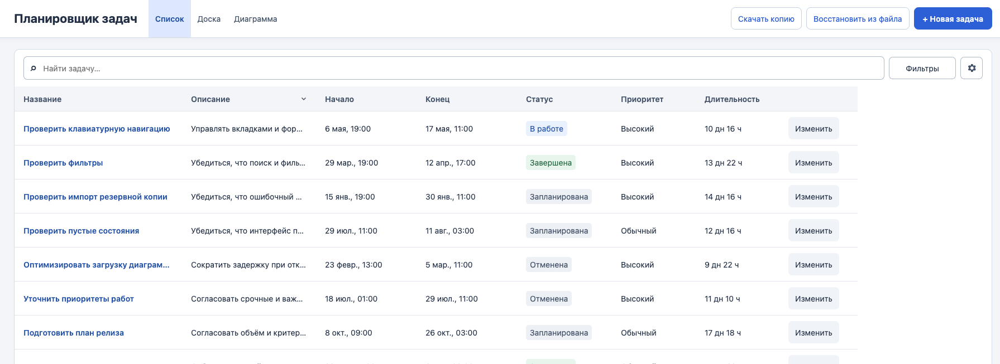
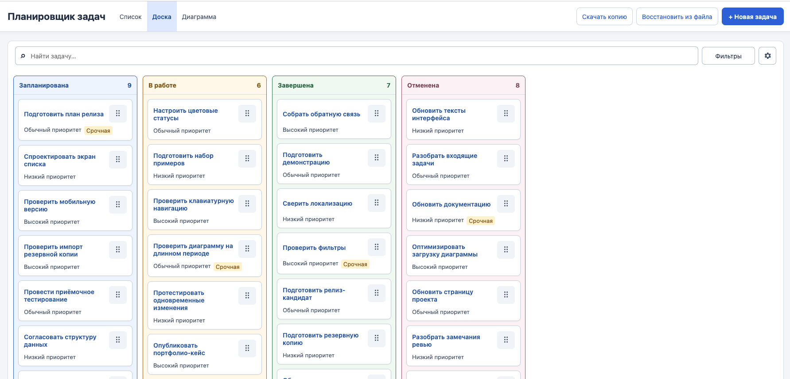
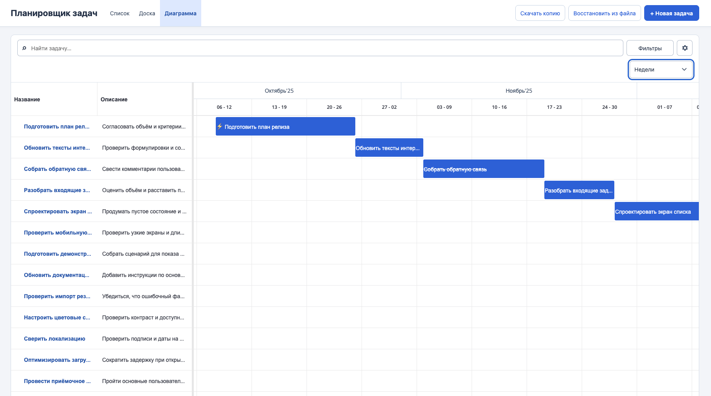

# Task Planner

A personal task planner with a sortable task list, Kanban board, and interactive Gantt chart.

Built as a portfolio project for managing tasks, deadlines, and priorities. Tasks are stored locally in the current browser; no account or backend is required.

## Preview

[Live demo](https://petrunenkovas.github.io/task-planner/)

<p align="center">
  
  
  
</p>

## Features

- Create tasks with descriptions, deadlines, status, priority, and urgency
- Browse tasks in a sortable list, a Kanban board, and a Gantt chart
- Move tasks and adjust their start and end times by dragging on the Gantt chart
- Search and filter tasks
- Choose which columns and card fields are displayed
- Export and restore tasks from a JSON backup

## Tech Stack

- React 19
- TypeScript
- Vite
- React Router
- SVAR React Gantt
- dnd-kit
- IndexedDB
- Zod

## Technical Highlights

- Local-first task storage with IndexedDB
- Gantt scheduling uses the system time zone
- Backup import validates the file before replacing tasks
- The task list, Kanban board, and Gantt chart use the same task data

## Getting Started

Requires Node.js 24 or later.

```bash
npm ci
npm run dev
```

Open **http://127.0.0.1:5173/#/list**.

Run the checks:

```bash
npm test
npm run build
```

## About This Project

This personal portfolio project was developed with the assistance of AI. Tasks are stored separately in each browser and are not synchronized between devices.
