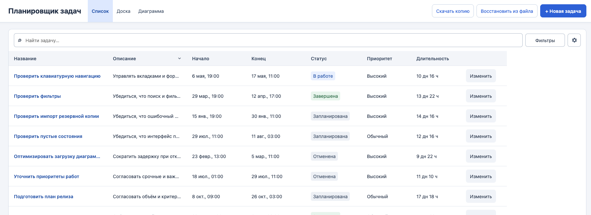
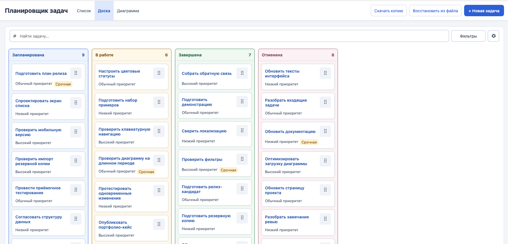
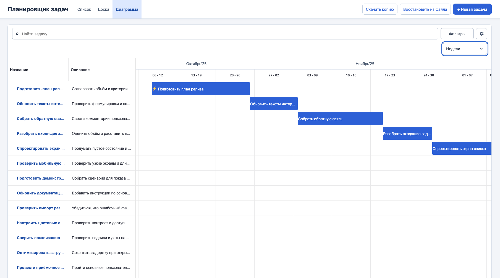

# Task Planner

A personal task planner with a sortable task list, Kanban board, and interactive Gantt chart.

Built as a portfolio project for managing tasks, deadlines, and priorities. Tasks are stored locally in the current browser; no account or backend is required.

## Preview

[Live demo](https://petrunenkovas.github.io/task-planner/)

<p align="center">
  
  
  
</p>

## Features

- Create tasks with descriptions, deadlines, status, priority, and urgency
- Add subtasks up to five levels deep and track them as a checklist
- Browse tasks in a sortable list, a Kanban board, and a Gantt chart
- Expand task branches in the list and Gantt chart
- Move tasks and adjust their start and end times by dragging on the Gantt chart
- Search and filter tasks
- Choose which columns and card fields are displayed
- Export and restore tasks from a JSON backup
- Load 30 synthetic example tasks into an empty planner

## Tech Stack

- React 19
- TypeScript
- Vite
- React Router
- SVAR React Gantt
- dnd-kit
- IndexedDB
- Zod

## Technical Highlights

- Local-first task storage with IndexedDB
- Atomic task updates and version checks for edits from multiple tabs
- Task date normalization keeps every child within its parent’s date range
- Gantt scheduling uses the system time zone
- Backup import validates the file, task hierarchy, and exportability before replacing tasks
- The task list, Kanban board, and Gantt chart use the same task data

## Architecture

`src/lib` contains the shared task model, date helpers, filtering, and sorting. Feature modules under `src/modules` contain the list, board, Gantt chart, and task storage. React Query coordinates the UI cache, while `taskRepository` owns the IndexedDB transactions. Preferences such as the selected columns and Gantt scale are stored in `localStorage`.

The planner reads the system time zone. Task timestamps are stored as absolute instants; the Gantt chart displays them using the browser’s local time. Very long date ranges are stopped before the chart mounts; select a broader scale or correct an outlying task date in the list.

The **Load examples** action appears when the task store is empty. It creates synthetic tasks only after a click and checks inside an IndexedDB transaction that no tasks have appeared in another tab. Back up personal tasks before restoring a JSON file: restoration replaces the current list.

## Getting Started

Requires Node.js 24 or later.

```bash
npm ci
npm run dev
```

Open **http://127.0.0.1:5173/#/list**.

Run the checks:

```bash
npm test
npm run format:check
npm run build
```

Pull Requests run the tests, formatting check, and production build in GitHub Actions. Publishing to GitHub Pages runs only from `main`.

## About This Project

This personal portfolio project was developed with the assistance of AI. Tasks are stored separately in each browser and are not synchronized between devices.
